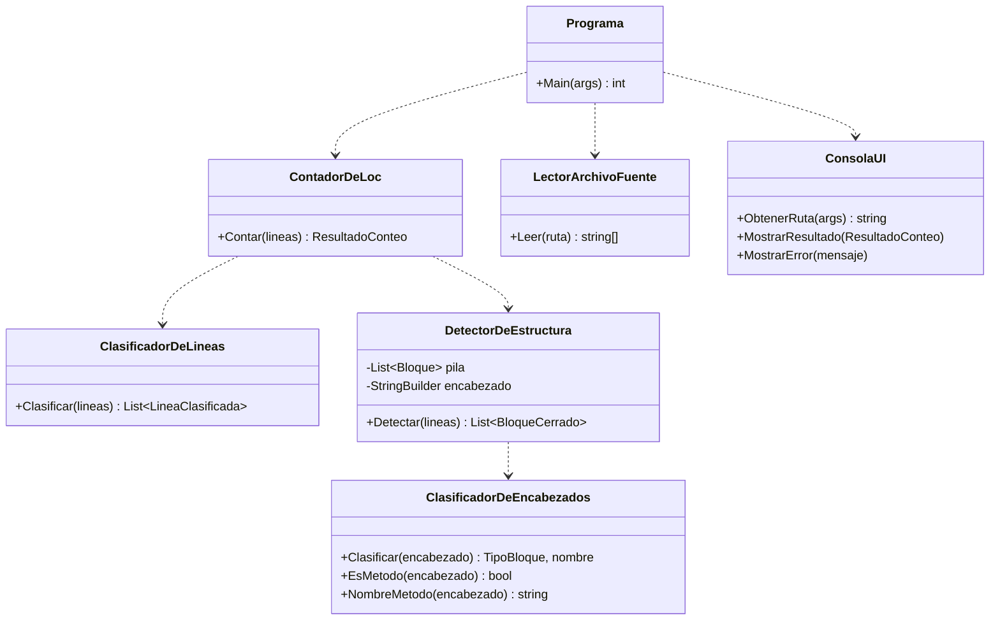

# Diseño complementario — UML, capas, interfaz y estándar de codificación

> Estas partes del Diseño faltaban para poder codificar. Revísalas **en la fase de Diseño** (con su cronómetro) y ajusta lo que quieras **antes** de empezar Código.

## Capas

| Capa | Contiene | Depende de |
|---|---|---|
| Dominio | `ClasificadorDeLineas`, `DetectorDeEstructura`, `ClasificadorDeEncabezados`, `ContadorDeLoc`, modelos y `ErrorDeConteoException` | nada |
| Infraestructura | `LectorArchivoFuente` (archivos) | Dominio |
| Presentación | `ConsolaUI` | Dominio (solo los resultados) |
| Aplicación | `Programa` | las tres anteriores |

El Dominio trabaja con una lista de líneas en memoria (RNF-03), así que se prueba sin archivos ni consola.

## Diagrama de clases



Modelos: `LineaClasificada`, `Bloque`, `BloqueCerrado`, `ResultadoClase`, `ResultadoMetodo`, `ResultadoConteo`, enum `TipoBloque`.

## Interfaz de consola

Uso: `dotnet run --project src -- datos/Ejemplo.cs`. Si falta el argumento, el programa pide la ruta.

Salida para `datos/Ejemplo.cs`:

```
Clases
Clase                            LOC   Métodos
Calculadora                       19         4
Mensajes                           7         1

Métodos
Clase.Método                     LOC
Calculadora.Calculadora            4
Calculadora.Sumar                  5
Calculadora.Doble                  1
Calculadora.Url                    4
Mensajes.Saludar                   4

Clases = 2
Métodos = 5
Total LOC = 30
```

| Escenario | Salida | Código |
|---|---|---|
| Archivo válido | Tablas de clases y métodos, y los tres totales | 0 |
| Archivo inexistente | `Error: archivo no encontrado: <ruta>` | 1 |
| Extensión distinta de `.cs` | `Error: el archivo debe ser .cs` | 1 |
| Archivo vacío o en blanco | `Error: el archivo no contiene código` | 1 |
| Llaves o comentarios mal cerrados | `Error: llaves sin cerrar` (o la causa que corresponda) | 1 |

## Estándar de codificación

Igual al del Programa 1, más:
- Métodos de **30 líneas o menos** (contando la firma y las llaves).
- Nombres en español sin tildes ni ñ.
- Los errores esperados se lanzan como `ErrorDeConteoException` y solo `Programa` los captura.
- Salida con `FormattableString.Invariant` (cultura invariante).
- 0 errores y 0 advertencias al compilar.
